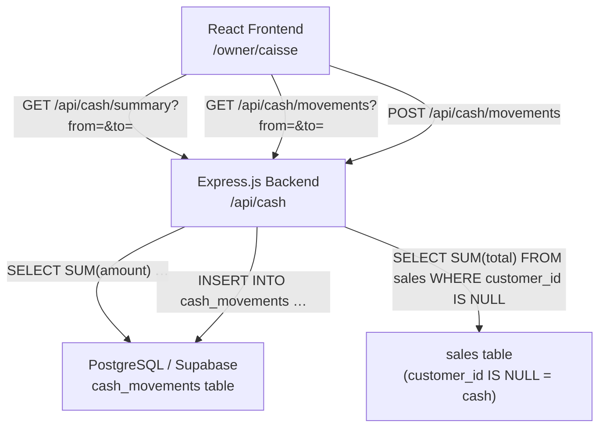
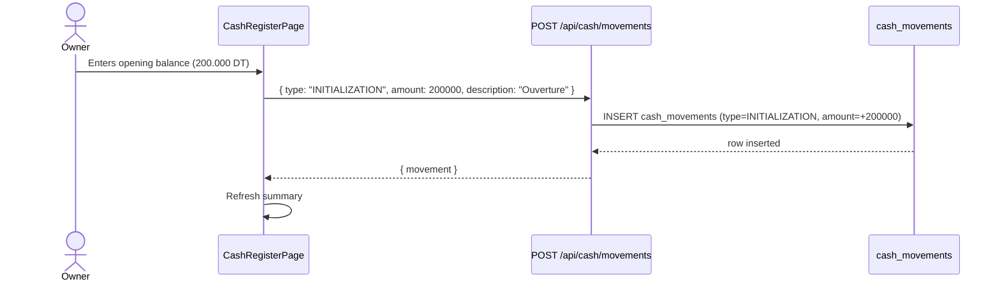
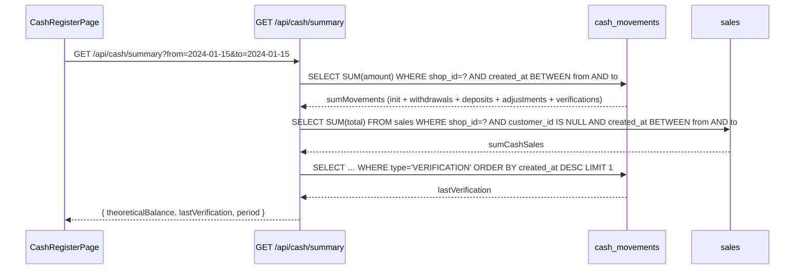
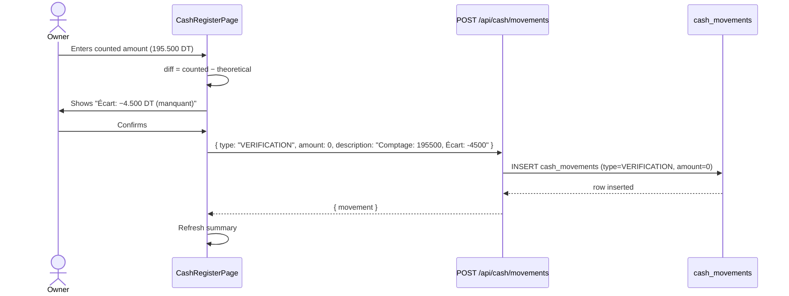

# Design Document: Cash Register Monitoring

## Overview

The Cash Register Monitoring feature gives shop owners a real-time view of the physical cash expected in the register versus what is actually counted. It tracks every money movement (initialization, cash sales, withdrawals, deposits, refunds) in an append-only ledger (`cash_movements`), computes a theoretical balance at any time, and lets the owner record a physical count to surface shortages or surpluses. The feature is owner-only and lives at `/owner/caisse` in the existing StockGuard React frontend.

The design integrates with the existing PostgreSQL schema (Supabase) and the Express.js backend conventions already in place. All amounts are stored as `bigint` in millimes (1 DT = 1000 millimes) to avoid floating-point rounding — consistent with every other monetary column in the project.

## Architecture



> Cash sales are sourced from the `sales` table (where `customer_id IS NULL`) and are **not** duplicated in `cash_movements` — the backend sums them on-the-fly when computing the theoretical balance. Manual actions (init, withdrawal, deposit, verification, refund) are written to `cash_movements`.

## Sequence Diagrams

### Opening a Session (Initialization)



### Computing Theoretical Balance



### Cash Verification



## Components and Interfaces

### Backend: `src/routes/cash.js`

**Purpose**: Express router for all cash register endpoints. Mounted at `/api/cash`.

**Interface** (Express routes):

```javascript
// GET  /api/cash/summary?from=ISO&to=ISO
// GET  /api/cash/movements?from=ISO&to=ISO&limit=50&offset=0
// POST /api/cash/movements
```

**Responsibilities**:
- Validate that the requesting user has role `OWNER` (via existing auth middleware)
- Compute theoretical balance by summing `cash_movements.amount` + cash sales from the `sales` table for the given period
- Insert new movements with server-side timestamp and `admin_id` from the authenticated session
- Return paginated movement history

### Frontend: `CashRegisterPage` (`src/pages/CashRegisterPage.js`)

**Purpose**: Top-level owner page at `/owner/caisse`. Orchestrates all sub-sections.

**Interface**:
```javascript
export default function CashRegisterPage()
// Props: none — reads shop/role from KioskContext
// State: summary, movements, activeTab, loading, error
```

**Responsibilities**:
- Fetch and display the summary card (theoretical balance, last verification, discrepancy indicator)
- Host the three-tab layout: Aperçu | Historique | Nouvelle action
- Delegate to child components for each tab

### Frontend: `CashSummaryCard` (`src/pages/CashRegisterPage.js`, inline or extracted)

**Purpose**: Top-of-page card showing key figures at a glance.

**Interface**:
```javascript
function CashSummaryCard({ summary, loading })
// summary: { theoreticalBalance, lastVerification, period }
```

### Frontend: `CashMovementsTable`

**Purpose**: Paginated, filterable table of all cash movements.

**Interface**:
```javascript
function CashMovementsTable({ movements, loading })
```

### Frontend: `CashActionPanel`

**Purpose**: Form panel for the four owner actions: Initialization, Withdrawal, Deposit, Verification.

**Interface**:
```javascript
function CashActionPanel({ onSuccess, theoreticalBalance })
// onSuccess: () => void — triggers parent to refresh summary + movements
```

## Data Models

### New DB Table: `cash_movements`

```sql
CREATE TYPE cash_movement_type AS ENUM (
  'INITIALIZATION',
  'WITHDRAWAL',
  'DEPOSIT',
  'CASH_REFUND',
  'ADJUSTMENT',
  'VERIFICATION'
);

CREATE TABLE cash_movements (
  id           uuid PRIMARY KEY DEFAULT gen_random_uuid(),
  shop_id      uuid NOT NULL REFERENCES shops(id),
  type         cash_movement_type NOT NULL,
  amount       bigint NOT NULL,
  description  text,
  sale_id      uuid REFERENCES sales(id),
  admin_id     uuid REFERENCES app_users(id),
  created_at   timestamptz NOT NULL DEFAULT now(),

  CONSTRAINT cm_amount_sign_chk CHECK (
      (type = 'INITIALIZATION' AND amount > 0)
   OR (type = 'WITHDRAWAL'     AND amount < 0)
   OR (type = 'DEPOSIT'        AND amount > 0)
   OR (type = 'CASH_REFUND'    AND amount < 0)
   OR (type = 'ADJUSTMENT'     AND amount <> 0)
   OR (type = 'VERIFICATION'   AND amount = 0)
  ),
  CONSTRAINT cm_sale_link_chk CHECK (
    sale_id IS NULL OR type = 'CASH_REFUND'
  )
);

CREATE INDEX cash_movements_shop_created_idx ON cash_movements (shop_id, created_at);
CREATE INDEX cash_movements_type_idx         ON cash_movements (shop_id, type, created_at);
```

**Sign convention** (consistent with `stock_movements`):
- Positive `amount` = money **in** (init, deposit)
- Negative `amount` = money **out** (withdrawal, refund)
- Zero `amount` for `VERIFICATION` rows — the counted amount is stored in `description` as a structured string

**Note on CASH_SALE**: Cash sales are **not** inserted here. They are summed directly from `sales WHERE customer_id IS NULL` to avoid double-write and stay consistent with the existing ledger.

### API Response Types (JavaScript)

```javascript
// GET /api/cash/summary response
{
  theoreticalBalance: number,  // bigint millimes
  sumCashSales:       number,
  sumMovements:       number,
  lastVerification: {
    id:          string,
    createdAt:   string,       // ISO
    description: string,       // e.g. "Comptage: 195500, Écart: -4500"
    countedAmount: number,     // parsed from description
    discrepancy:   number,     // countedAmount - theoreticalBalance at time of check
  } | null,
  period: { from: string, to: string }
}

// POST /api/cash/movements request body
{
  type:        'INITIALIZATION' | 'WITHDRAWAL' | 'DEPOSIT' | 'CASH_REFUND' | 'ADJUSTMENT' | 'VERIFICATION',
  amount:      number,     // millimes, signed
  description: string,
  sale_id?:    string | null
}

// GET /api/cash/movements response
{
  movements: Array<{
    id:          string,
    type:        string,
    amount:      number,
    description: string,
    admin_id:    string | null,
    created_at:  string,
  }>,
  total: number,
  offset: number
}
```

## Algorithmic Pseudocode

### Theoretical Balance Computation

```pascal
FUNCTION computeTheoreticalBalance(shopId, from, to)
  INPUT: shopId UUID, from timestamptz, to timestamptz
  OUTPUT: balance bigint (millimes)

  BEGIN
    // Step 1: Sum all manual cash movements for the period
    sumMovements ← SELECT SUM(amount)
                   FROM cash_movements
                   WHERE shop_id = shopId
                     AND type IN ('INITIALIZATION', 'WITHDRAWAL', 'DEPOSIT', 'CASH_REFUND', 'ADJUSTMENT')
                     AND created_at BETWEEN from AND to

    // Step 2: Sum all cash sales (customer_id IS NULL) for the period
    sumCashSales ← SELECT SUM(total)
                   FROM sales
                   WHERE shop_id = shopId
                     AND customer_id IS NULL
                     AND created_at BETWEEN from AND to

    // Step 3: Combine
    balance ← COALESCE(sumMovements, 0) + COALESCE(sumCashSales, 0)

    RETURN balance
  END
```

**Preconditions**:
- `shopId` exists in the `shops` table
- `from` ≤ `to`

**Postconditions**:
- Returns the sum of all money-in and money-out entries for the period
- Result is 0 if no movements or sales exist for that period
- `VERIFICATION` rows are excluded from the sum (they are snapshots, not flows)

**Loop invariants**: N/A (single aggregation query)

### Discrepancy Check (Frontend)

```pascal
FUNCTION computeDiscrepancy(countedAmountDT, theoreticalBalance)
  INPUT: countedAmountDT  number (DT with decimals, user input)
         theoreticalBalance bigint (millimes)
  OUTPUT: { countedMillimes, discrepancy, status }

  BEGIN
    countedMillimes ← ROUND(countedAmountDT * 1000)

    IF countedMillimes < 0 THEN
      THROW "Montant invalide"
    END IF

    discrepancy ← countedMillimes − theoreticalBalance

    IF discrepancy < 0 THEN
      status ← "SHORTAGE"
    ELSE IF discrepancy > 0 THEN
      status ← "SURPLUS"
    ELSE
      status ← "BALANCED"
    END IF

    RETURN { countedMillimes, discrepancy, status }
  END
```

**Preconditions**:
- `countedAmountDT` is a non-negative number (from validated form input)
- `theoreticalBalance` is the value returned by `computeTheoreticalBalance`

**Postconditions**:
- `discrepancy = 0` iff `status = "BALANCED"`
- `discrepancy < 0` iff `status = "SHORTAGE"`
- `discrepancy > 0` iff `status = "SURPLUS"`

### New Movement Validation (Backend)

```pascal
FUNCTION validateCashMovement(body, role)
  INPUT: body { type, amount, description, sale_id? }, role string
  OUTPUT: validatedPayload OR throws HTTP 400/403

  BEGIN
    IF role ≠ 'OWNER' THEN
      THROW 403 "Accès réservé au propriétaire."
    END IF

    IF type NOT IN ALLOWED_TYPES THEN
      THROW 400 "Type de mouvement invalide."
    END IF

    IF type = 'INITIALIZATION' AND amount ≤ 0 THEN
      THROW 400 "Le solde d'ouverture doit être positif."
    END IF

    IF type = 'WITHDRAWAL' AND amount ≥ 0 THEN
      THROW 400 "Un retrait doit avoir un montant négatif."
    END IF

    IF type = 'DEPOSIT' AND amount ≤ 0 THEN
      THROW 400 "Un dépôt doit avoir un montant positif."
    END IF

    IF type = 'VERIFICATION' AND amount ≠ 0 THEN
      THROW 400 "Le montant d'une vérification doit être 0."
    END IF

    IF length(TRIM(description)) = 0 THEN
      THROW 400 "La description est obligatoire."
    END IF

    RETURN { type, amount, description, sale_id: body.sale_id OR NULL }
  END
```

## Key Functions with Formal Specifications

### `GET /api/cash/summary` handler

```javascript
async function getSummary(req, res)
// req.query: { from?: string, to?: string }
// req.shopId: UUID (from auth middleware)
```

**Preconditions**:
- Request is authenticated as OWNER
- `from` and `to` are valid ISO date strings (or absent → defaults to today)

**Postconditions**:
- Returns HTTP 200 with `{ theoreticalBalance, sumCashSales, sumMovements, lastVerification, period }`
- `theoreticalBalance = sumMovements + sumCashSales`
- Never returns HTTP 500 for a shop with no movements (returns 0s instead)

### `POST /api/cash/movements` handler

```javascript
async function createMovement(req, res)
// req.body: { type, amount, description, sale_id? }
// req.shopId, req.userId: from auth middleware
```

**Preconditions**:
- Request is authenticated as OWNER
- `type` ∈ `{ INITIALIZATION, WITHDRAWAL, DEPOSIT, CASH_REFUND, ADJUSTMENT, VERIFICATION }`
- `amount` satisfies sign constraints per type
- `description` is non-empty

**Postconditions**:
- One row inserted into `cash_movements` with `shop_id = req.shopId`, `admin_id = req.userId`, server-set `created_at`
- Returns HTTP 201 with the inserted row
- If DB constraint is violated, returns HTTP 400 (not 500)

**Loop invariants**: N/A

### `dt(millimes)` — amount formatter (frontend, matches existing convention)

```javascript
const dt = (m) => (m / 1000).toFixed(3) + " DT"
// Precondition:  m is a finite integer
// Postcondition: returns string like "12.500 DT"
// Pure function, no side effects
```

### `useCashRegister()` — custom hook

```javascript
function useCashRegister(shopId)
// Returns: { summary, movements, loading, error, refresh, createMovement }
```

**Preconditions**:
- `shopId` is non-null (user is logged in)

**Postconditions**:
- `summary` is populated after first successful fetch
- `createMovement(payload)` calls `POST /api/cash/movements` and calls `refresh()` on success
- `loading` is `true` only during active network requests

## Example Usage

### Frontend — Posting a Withdrawal

```javascript
// In CashActionPanel:
const handleWithdraw = async (e) => {
  e.preventDefault();
  const amtMillimes = -Math.round(parseFloat(amtDT) * 1000); // negative
  if (amtMillimes >= 0) { toast("Montant invalide."); return; }

  const res = await fetch("/api/cash/movements", {
    method: "POST",
    headers: { "Content-Type": "application/json" },
    body: JSON.stringify({
      type:        "WITHDRAWAL",
      amount:      amtMillimes,
      description: reason,
    }),
  });
  if (!res.ok) { toast("Erreur lors du retrait."); return; }
  toast("Retrait enregistré ✓");
  onSuccess();
};
```

### Backend — Summary SQL Query

```javascript
// In src/routes/cash.js
const { rows: [movRow] } = await db.query(`
  SELECT COALESCE(SUM(amount), 0)::bigint AS sum_movements
  FROM   cash_movements
  WHERE  shop_id   = $1
    AND  type     != 'VERIFICATION'
    AND  created_at BETWEEN $2 AND $3
`, [shopId, from, to]);

const { rows: [saleRow] } = await db.query(`
  SELECT COALESCE(SUM(total), 0)::bigint AS sum_cash_sales
  FROM   sales
  WHERE  shop_id      = $1
    AND  customer_id IS NULL
    AND  created_at  BETWEEN $2 AND $3
`, [shopId, from, to]);

const theoreticalBalance = Number(movRow.sum_movements) + Number(saleRow.sum_cash_sales);
```

### Frontend — Verification Flow

```javascript
// computeDiscrepancy used before POST
const { countedMillimes, discrepancy, status } = computeDiscrepancy(
  parseFloat(countedDT),
  summary.theoreticalBalance
);

// description encodes both values for history display
const description = `Comptage: ${countedMillimes}, Écart: ${discrepancy}`;

await fetch("/api/cash/movements", {
  method: "POST",
  headers: { "Content-Type": "application/json" },
  body: JSON.stringify({ type: "VERIFICATION", amount: 0, description }),
});
```

## Correctness Properties

### Property 1: Theoretical Balance Completeness

For any period [from, to], `theoreticalBalance = SUM(cash_movements.amount WHERE type != 'VERIFICATION') + SUM(sales.total WHERE customer_id IS NULL)`, both bounded to [from, to].

**Validates: Requirements 2.1**

### Property 2: Verification Rows Are Neutral

A `VERIFICATION` row's `amount` is always 0 and never contributes to the theoretical balance computation.

**Validates: Requirements 3.1**

### Property 3: Amount Sign Constraints

For any `WITHDRAWAL` movement in the DB, `amount < 0`; for any `INITIALIZATION` or `DEPOSIT`, `amount > 0` — enforced by the DB CHECK constraint.

**Validates: Requirements 1.1, 4.1**

### Property 4: Discrepancy Correctness

The discrepancy shown to the user equals `counted − theoreticalBalance`; a negative discrepancy means shortage, a positive discrepancy means surplus, and zero means balanced.

**Validates: Requirements 3.2**

### Property 5: Append-Only Ledger

The `cash_movements` table is append-only: no UPDATE or DELETE queries are issued by any backend handler.

**Validates: Requirements 5.1**

### Property 6: Owner-Only Access

Only users with `role = 'OWNER'` can POST to `/api/cash/movements` (enforced in auth middleware before the route handler executes).

**Validates: Requirements 6.1**

## Error Handling

### Invalid Amount Input

**Condition**: User submits a non-numeric or zero/negative amount for init/deposit/withdrawal.  
**Response**: Frontend validates before submission; shows toast "Montant invalide." — no API call is made.  
**Recovery**: Form remains open with current values.

### No Initialization Found

**Condition**: Owner opens the page before any `INITIALIZATION` movement exists.  
**Response**: Backend returns `theoreticalBalance: 0`; frontend shows an empty-state prompt inside the Aperçu tab: "Aucune caisse initialisée. Utilisez 'Nouvelle action → Initialisation'."  
**Recovery**: Owner performs an initialization action.

### DB Constraint Violation

**Condition**: Backend receives a payload violating a CHECK constraint (e.g., positive amount for WITHDRAWAL).  
**Response**: Backend catches the PostgreSQL error code `23514` and returns HTTP 400 with a French error message.  
**Recovery**: Client shows the error message in a toast; the user can correct and resubmit.

### Network / Server Error

**Condition**: Fetch call fails or returns HTTP 5xx.  
**Response**: Toast "Erreur de connexion. Veuillez réessayer." — existing pattern from other pages.  
**Recovery**: User can retry; no partial state is written (atomic INSERT).

## Testing Strategy

### Unit Testing Approach

Test `computeDiscrepancy` and `computeTheoreticalBalance` as pure functions with boundary cases:
- Zero balance (no init, no sales)
- Balance exactly equal to counted → BALANCED
- Counted below theoretical → SHORTAGE
- Counted above theoretical → SURPLUS
- Very large values (bigint overflow guard)

### Property-Based Testing Approach

**Property Test Library**: fast-check (already compatible with React ecosystem)

Key properties:
- `∀ countedAmt ≥ 0, theoretical`: `discrepancy = countedAmt − theoretical`; `status ∈ {SHORTAGE, BALANCED, SURPLUS}` with correct boundaries
- `∀ validMovement payload`: the sign-check validation accepts it iff the amount sign matches the type constraint

### Integration Testing Approach

- POST `/api/cash/movements` with each valid type → verify DB row and HTTP 201
- GET `/api/cash/summary` after a sequence of movements → verify `theoreticalBalance` matches manual calculation
- POST with wrong amount sign → verify HTTP 400

## Performance Considerations

- Summary computation is a two-query aggregate: O(n) in the period's rows but indexed on `(shop_id, created_at)`. For typical small-shop volumes (<10 k movements/year) this is instantaneous.
- Movement history is paginated (`LIMIT 50 OFFSET ?`) to avoid large payloads.
- No real-time updates are needed; the page refreshes after each action via `refresh()`.

## Security Considerations

- All `/api/cash/*` routes require authentication and `role = 'OWNER'`. A cashier cannot access or modify cash movements.
- Amount values are `bigint` server-side; the frontend always multiplies user DT input × 1000 and rounds before sending — no floating-point amounts ever reach the DB.
- `description` is stored as free text; it is rendered as `textContent` / inside JSX (not `dangerouslySetInnerHTML`), preventing XSS.
- `admin_id` is taken from the server session, never from the request body — prevents spoofing.

## Dependencies

- **Frontend**: React, React Router (already in project), existing `KioskContext` for `kiosk.id` and toast
- **Backend**: `express`, `pg` (PostgreSQL client, assumed from project conventions), existing auth middleware
- **DB**: PostgreSQL 15+ / Supabase — new migration file for `cash_movement_type` enum and `cash_movements` table
- **No new npm packages required**
